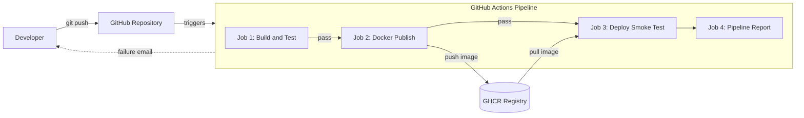

# CI/CD Pipeline Automation System

[](https://github.com/akshat788/cicd-pipeline-project/actions/workflows/ci.yml)

A Flask web application with a fully automated pipeline: every `git push` to `main`
is tested, packaged as a Docker image, published to GitHub Container Registry, and
verified by pulling and running the published image.

## Pipeline architecture

## Pipeline architecture



A failing stage stops everything after it, so broken code is never published.

## Tech stack

| Area | Tool |
|---|---|
| Application | Python, Flask |
| Production server | Gunicorn |
| Testing | pytest |
| Version control | Git, GitHub |
| CI/CD | GitHub Actions |
| Containers | Docker |
| Registry | GitHub Container Registry (GHCR) |

## API endpoints

| Route | Response |
|---|---|
| `/` | Hello message and version |
| `/health` | `{"status": "ok"}` |
| `/add/<a>/<b>` | Sum of two integers |

## Run locally

```
python -m venv venv
venv\Scripts\activate
python -m pip install -r requirements.txt
python -m pytest
python app.py
```

## Run with Docker

```
docker build -t cicd-flask-app:1.0 .
docker run -d --name flask-app -p 5000:5000 cicd-flask-app:1.0
```

Or use the image published by the pipeline:

```
docker pull ghcr.io/akshat788/cicd-pipeline-project:latest
```

## Project structure

```
.github/workflows/ci.yml   pipeline definition
app.py                     Flask application
test_app.py                automated tests
requirements.txt           Python dependencies
Dockerfile                 container image recipe
.dockerignore              files excluded from the image
```

## Author

Akshat Jaiswal, ASET, B.tech (CSE), Sharda University Agra